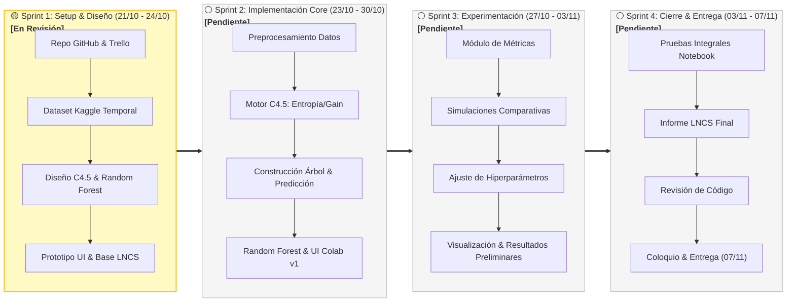

# TPI Inteligencia Artificial 2026 - Clasificación: Decision Tree vs Random Forest

[](https://colab.research.google.com/github/DanielBenjaminLopez/IA-DecisionTree/blob/main/TPI_IA_Clasificacion.ipynb)
[](https://www.python.org/)
[](https://opensource.org/licenses/MIT)
[](#)

Trabajo Práctico Integrador para la cátedra de **Inteligencia Artificial (5º Nivel - Ingeniería en Sistemas de Información)**, ciclo lectivo 2026.

El proyecto consiste en el diseño, desarrollo desde cero y validación experimental de un algoritmo de **Árbol de Decisión (C4.5 de Quinlan)**, y su posterior comparación exhaustiva contra el modelo de ensamble **Random Forest (Scikit-Learn)** en tareas de clasificación supervisada.

---

## 📌 Tabla de Contenidos
- [Características Principales](#-características-principales)
- [Estructura del Proyecto](#-estructura-del-proyecto)
- [Ejecución en Google Colab](#-ejecución-en-google-colab)
- [Ejecución Local](#-ejecución-local)
- [Modelos Implementados](#-modelos-implementados)
- [Métricas y Comparativa](#-métricas-y-comparativa)
- [Planificación y Metodología](#-planificación-y-metodología)
- [Informe Académico (LNCS)](#-informe-académico-lncs)
- [Equipo de Desarrollo](#-equipo-de-desarrollo)
- [Referencias](#-referencias)

---

## 🚀 Características Principales

- **Decision Tree C4.5 desarrollado íntegramente por el equipo (desde cero):**
  - Soporte para variables continuas (bipartición dinámica evaluando umbrales candidatos).
  - Soporte para variables categóricas.
  - Criterios de división seleccionables: **Information Gain** (Entropía de Shannon) y **Gain Ratio** (Razón de Ganancia de Quinlan).
  - Control de hiperparámetros y prepoda: profundidad máxima (`max_depth`), mínimo de muestras para división (`min_samples_split`).
- **Random Forest (Scikit-learn):**
  - Parametrización dinámica (`n_estimators`, `max_depth`, `criterion`).
- **Interfaz Interactiva (Google Colab):**
  - Controles amigables con `ipywidgets` para cargar datos, ajustar parámetros, entrenar modelos y visualizar resultados en tiempo real sin modificar código.
- **Evaluación Exhaustiva:**
  - Matriz de confusión visual e interactiva.
  - Métricas completas: Accuracy, Precision, Recall, F1-Score, Curva ROC-AUC.
  - Medición comparativa de tiempos de cómputo (entrenamiento e inferencia).

---

## 📂 Estructura del Proyecto

```text
.
├── data/
│   ├── provisional_kaggle.csv  # Dataset preliminar con variables continuas y categóricas
│   ├── oficial_catedra.csv     # Dataset definitivo provisto por la cátedra
│   └── README.md               # Documentación y descripción de variables
├── informe/
│   ├── figures/                # Gráficos, curvas ROC y matrices de confusión
│   ├── informe_fuente.tex      # Código fuente LaTeX (plantilla Springer LNCS)
│   ├── referencias.bib         # Citas bibliográficas en formato BibTeX
│   ├── informe_LNCS.pdf        # Versión final compilada del informe (máx. 12 páginas)
│   └── README.md               # Guía de redacción y formato (LaTeX y Word)
├── src/                        # Módulos Python estructurados
│   ├── __init__.py
│   ├── decision_tree.py        # Implementación del algoritmo C4.5 desde cero
│   ├── random_forest.py        # Wrapper y utilidades para Random Forest
│   └── evaluator.py            # Métricas de rendimiento, validación y matrices
├── TPI_IA_Clasificacion.ipynb  # Notebook principal autónomo para Google Colab
├── requirements.txt            # Dependencias del proyecto
├── .gitignore                  # Exclusiones de Git
└── README.md                   # Documentación principal
```

---

## 💻 Ejecución en Google Colab

1. Haz clic en el botón superior **"Open in Colab"** o sube `TPI_IA_Clasificacion.ipynb` a tu cuenta de Google Colab.
2. Ejecuta las celdas en orden o selecciona `Entorno de ejecución > Ejecutar todo`.
3. Utiliza la **Interfaz Gráfica Interactiva** en el notebook para:
   - Seleccionar el archivo de datos (`data/provisional_kaggle.csv` o `data/oficial_catedra.csv`).
   - Configurar hiperparámetros para Decision Tree y Random Forest.
   - Presionar **"Entrenar y Comparar"**.
   - Analizar las métricas y gráficos comparativos.

---

## ⚙️ Ejecución Local

Para ejecutar el entorno en un equipo local:

```bash
# 1. Clonar el repositorio
git clone https://github.com/DanielBenjaminLopez/IA-DecisionTree.git
cd IA-DecisionTree

# 2. Crear entorno virtual e instalar dependencias
python3 -m venv .venv
source .venv/bin/activate  # En Windows: .venv\Scripts\activate
pip install -r requirements.txt

# 3. Iniciar Jupyter
jupyter lab TPI_IA_Clasificacion.ipynb
```

---

## 🧠 Modelos Implementados

### 1. Decision Tree (C4.5 - Quinlan)
El algoritmo selecciona el mejor atributo de división calculando la Razón de Ganancia (*Gain Ratio*):
$$\text{GainRatio}(S, A) = \frac{\text{Gain}(S, A)}{\text{SplitInfo}(S, A)}$$
donde la ganancia de información mide la reducción de la entropía de Shannon:
$$\text{Gain}(S, A) = \text{Entropy}(S) - \sum_{v \in \text{Valores}(A)} \frac{|S_v|}{|S|} \text{Entropy}(S_v)$$
$$\text{SplitInfo}(S, A) = - \sum_{v \in \text{Valores}(A)} \frac{|S_v|}{|S|} \log_2 \frac{|S_v|}{|S|}$$

### 2. Random Forest (Breiman)
Ensamble de múltiples árboles de decisión entrenados sobre subconjuntos *bootstrap* del dataset y subconjuntos aleatorios de atributos, promediando la votación de la mayoría (*majority voting*) para minimizar la varianza del modelo.

---

## 📊 Métricas y Comparativa

El módulo de evaluación compara de forma sistemática:
- **Matriz de Confusión** (TP, TN, FP, FN).
- **Exactitud (Accuracy):** $\frac{TP + TN}{TP + TN + FP + FN}$
- **Precisión:** $\frac{TP}{TP + FP}$
- **Sensibilidad (Recall):** $\frac{TP}{TP + FN}$
- **F1-Score:** $2 \cdot \frac{\text{Precision} \cdot \text{Recall}}{\text{Precision} + \text{Recall}}$
- **Curva ROC y Área bajo la curva (AUC)**
- **Tiempos de cómputo** (tiempo de entrenamiento e inferencia en segundos).

---

## 📅 Planificación y Metodología

El proyecto se gestiona mediante una metodología de desarrollo ágil iterativa dividida en **4 Sprints**, con seguimiento continuo en **Trello**:
🔗 **[Tablero de Trello del Proyecto](https://trello.com/)** *(Actualizar con el enlace público o de la cátedra)*

### 🔄 Flujo de Trabajo en Trello (Kanban)
```text
📥 [1. Backlog] ──▶ 📋 [2. To Do] ──▶ ⚙️ [3. In Progress] ──▶ 🧪 [4. Review / QA] ──▶ ✅ [5. Done]
```

---

### 🗺️ Roadmap Visual del Proyecto



---

### 📌 Desglose Detallado por Sprints

#### 🟡 Sprint 1: Cimientos, Diseño y Configuración Inicial (21/10 – 24/10) — `[🟡 En revisión por el equipo]`
> **Meta del Sprint:** Establecer el repositorio, herramientas de seguimiento, dataset preliminar, arquitectura algorítmica y plantilla del informe LNCS.

| Código | Tarea | Responsable | Plazo | Estado |
| :---: | :--- | :---: | :---: | :---: |
| `S1-01` | Configurar Trello y repositorio GitHub | Integrante 3 | 21/10 – 21/10 | 🟢 Completado |
| `S1-02` | Analizar el dataset (Kaggle temporal) | Integrante 2 | 21/10 – 23/10 | 🟡 En progreso (Revisión) |
| `S1-03` | Investigar y diseñar Decision Tree (C4.5) | Integrante 1 | 21/10 – 23/10 | 🟡 En progreso (Revisión) |
| `S1-04` | Diseñar evaluación de Random Forest | Integrante 4 | 21/10 – 23/10 | 🟡 En progreso (Revisión) |
| `S1-05` | Diseñar prototipo de interfaz Colab (`ipywidgets`) | Integrante 3 | 22/10 – 24/10 | 🟡 En progreso (Revisión) |
| `S1-06` | Crear estructura inicial del informe LNCS | Integrante 4 | 21/10 – 23/10 | 🟡 En progreso (Revisión) |

---

#### ⚪ Sprint 2: Desarrollo Algorítmico y Modelos Base (23/10 – 30/10) — `[⚪ Pendiente]`
> **Meta del Sprint:** Construir el motor C4.5 desde cero, integrar Random Forest en Scikit-learn, pipeline de datos y primera UI funcional.

| Código | Tarea | Responsable | Plazo | Estado |
| :---: | :--- | :---: | :---: | :---: |
| `S2-01` | Implementar preprocesamiento de datos | Integrante 2 | 23/10 – 26/10 | ⚪ Pendiente |
| `S2-02` | Implementar cálculos de ganancia y divisiones de DT | Integrante 1 | 23/10 – 27/10 | ⚪ Pendiente |
| `S2-04` | Implementar wrapper de Random Forest | Integrante 2 | 24/10 – 27/10 | ⚪ Pendiente |
| `S2-03` | Construir árbol recursivo y función de predicción | Integrante 1 | 27/10 – 29/10 | ⚪ Pendiente |
| `S2-05` | Implementar primera interfaz interactiva en Colab | Integrante 3 | 27/10 – 30/10 | ⚪ Pendiente |
| `S2-06` | Documentar implementación técnica interna | Integrante 4 | 24/10 – 30/10 | ⚪ Pendiente |

---

#### ⚪ Sprint 3: Métricas, Optimización y Experimentación (27/10 – 03/11) — `[⚪ Pendiente]`
> **Meta del Sprint:** Validar ambos modelos, explorar hiperparámetros, generar matrices de confusión y redactar resultados preliminares.

| Código | Tarea | Responsable | Plazo | Estado |
| :---: | :--- | :---: | :---: | :---: |
| `S3-02` | Implementar métricas de evaluación (Accuracy, F1, etc.) | Integrante 2 | 27/10 – 30/10 | ⚪ Pendiente |
| `S3-01` | Validar y mejorar Decision Tree (poda/overfitting) | Integrante 1 | 29/10 – 01/11 | ⚪ Pendiente |
| `S3-03` | Ejecutar experimentos comparativos sistemáticos | Integrante 4 | 30/10 – 02/11 | ⚪ Pendiente |
| `S3-04` | Integrar visualizaciones interactivas y gráficos en UI | Integrante 3 | 31/10 – 03/11 | ⚪ Pendiente |
| `S3-05` | Redactar resultados preliminares y análisis | Integrante 4 | 02/11 – 03/11 | ⚪ Pendiente |

---

#### ⚪ Sprint 4: Integración, Informe LNCS y Presentación (03/11 – 07/11) — `[⚪ Pendiente]`
> **Meta del Sprint:** Cierre de experimentos, redacción del paper LNCS (≤12 carillas), revisión de código y preparación para el coloquio.

| Código | Tarea | Responsable | Plazo | Estado |
| :---: | :--- | :---: | :---: | :---: |
| `S4-01` | Realizar pruebas integrales del notebook en Colab | Integrante 3 | 03/11 – 05/11 | ⚪ Pendiente |
| `S4-02` | Cerrar conclusiones y análisis comparativo | Integrante 2 | 03/11 – 04/11 | ⚪ Pendiente |
| `S4-03` | Completar redacción y formato de informe LNCS | Integrante 4 | 03/11 – 05/11 | ⚪ Pendiente |
| `S4-04` | Revisar código y documentación técnica interna | Integrante 1 | 05/11 – 06/11 | ⚪ Pendiente |
| `S4-05` | Preparar presentación y defensa para el coloquio | Integrante 3 | 05/11 – 06/11 | ⚪ Pendiente |
| `S4-06` | Verificar entregables finales y presentar TP | Integrante 4 | 07/11 – 07/11 | ⚪ Pendiente |

---

### 🎯 Cronograma de Hitos Críticos (Milestones)

```text
📅 21/10/2026: 🚀 Inicio del proyecto, repo configurado y S1 completado
📅 30/10/2026: 🧩 Modelos base DT (C4.5) y RF operativos en Colab
📅 03/11/2026: 📊 Conclusión de simulaciones comparativas y gráficos
📅 05/11/2026: 📝 Borrador final del informe LNCS listo para revisión
📅 07/11/2026: 🏁 Entrega formal del TP (con margen previo al límite del 11/11)
📅 11/11/2026: ⚠️ FECHA LÍMITE OFICIAL DE LA CÁTEDRA (23:59 hs)
```

---

## 👥 Matriz de Responsabilidades y Equipo de Desarrollo

| Integrante | Rol Principal | Especialidad Técnica | Tareas Asignadas |
| :--- | :--- | :--- | :--- |
| **Integrante 1** | Arquitectura Algorítmica | Motor C4.5, Entropía, Gain Ratio, recursión y predicción | `S1-03`, `S2-02`, `S2-03`, `S3-01`, `S4-04` |
| **Integrante 2** | Modelos & Preprocesamiento | Pipeline de datos, Random Forest (Sklearn) y métricas | `S1-02`, `S2-01`, `S2-04`, `S3-02`, `S4-02` |
| [**Daniel Benjamín López**](https://github.com/DanielBenjaminLopez) (Integrante 3) | UI & Experiencia de Usuario | Google Colab, interactividad con `ipywidgets` y testing UX | `S1-01`, `S1-05`, `S2-05`, `S3-04`, `S4-01`, `S4-05` |
| **Integrante 4** | Documentación Académica & QA | Informe Springer LNCS, control Trello y simulaciones | `S1-04`, `S1-06`, `S2-06`, `S3-03`, `S3-05`, `S4-03`, `S4-06` |

---

## 📚 Referencias

1. **Quinlan, J. R.** (1993). *C4.5: Programs for Machine Learning*. Morgan Kaufmann Publishers.
2. **Liu, Bing.** (2011). *Web Data Mining: Exploring Hyperlinks, Contents, and Usage Data* (2nd ed., p. 67). Springer.
3. **Breiman, L.** (2001). *Random Forests*. Machine Learning, 45(1), 5–32.
4. **Pedregosa, F., et al.** (2011). *Scikit-learn: Machine Learning in Python*. Journal of Machine Learning Research, 12, 2825–2830.
5. **Springer.** *Lecture Notes in Computer Science (LNCS) Author Guidelines*. [Springer Guidelines](https://www.springer.com/gp/computer-science/lncs/conference-proceedings-guidelines).